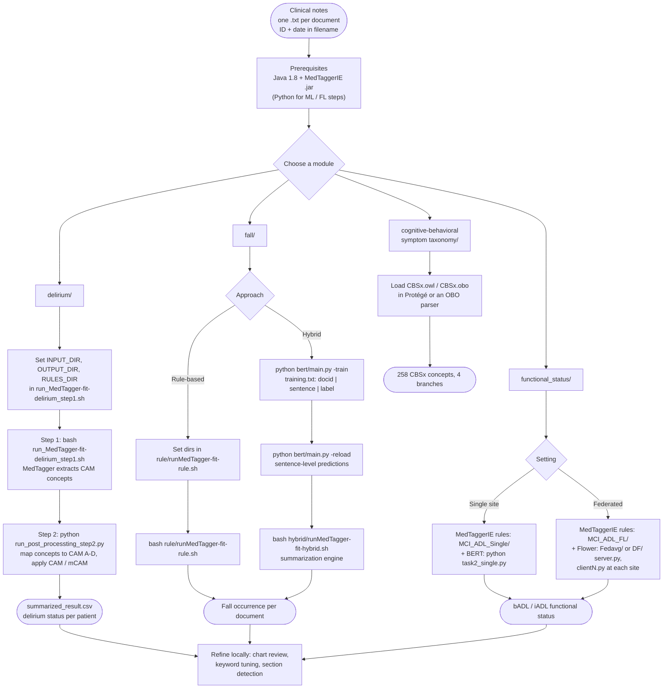

# AgingNLP

This repository aims to disseminate NLP resources for aging, gerontology and geriatrics medicine, including NLP algorithms, knowledge bases, taxonomies, and lexicons, to support the development and evaluation of various NLP applications.

This initiative is a collaboration among several leading institutions, including:

- [Rochester Epidemiology Project](https://rochesterproject.org/)
- [Mayo Clinic Department of AI & Informatics](https://www.mayo.edu/research/departments-divisions/artificial-intelligence-informatics/overview)
- [Mayo Clinic Department of Quantitative Health Sciences](https://www.mayo.edu/research/departments-divisions/quantitative-health-sciences/overview)
- [UTHealth Center for Translational AI Excellence and Applications in Medicine](https://sbmi.uth.edu/center-translational-ai/)
- [John P. and Kathrine G. McGovern Medical School](https://med.uth.edu/)
- [Memorial Hermann Health System](https://www.memorialhermann.org/)
- [ENACT NLP Working Group](https://www.enact-network.us/)
- [OHDSI NLP and Aging Working Group](https://ohdsi.org/workgroups/)

All related NLP resources can be accessed under the OHNLP consortium, which aims to create an interoperable, scalable, and usable NLP ecosystem.

## Quick Start

See each module's README for full configuration details.

## Reference

### Delirium
Fu S, Lopes GS, Pagali SR, Thorsteinsdottir B, LeBrasseur NK, Wen A, Liu H, Rocca WA, Olson JE, St. Sauver J, Sohn S. Ascertainment of delirium status using natural language processing from electronic health records. The Journals of Gerontology: Series A. 2022 Mar 1;77(3):524-30. 
https://doi.org/10.1093/gerona/glaa275

Sauver JS, Fu S, Sohn S, Weston S, Fan C, Olson J, Thorsteinsdottir B, LeBrasseur N, Pagali S, Rocca W, Liu H. Identification of delirium from real-world electronic health record clinical notes. Journal of Clinical and Translational Science. 2023 Jan;7(1):e187.
https://doi.org/10.1017/cts.2023.610

Pagali S, Fu S, Lindroth H, Sohn S, Burton MC, Lapid M. Delirium occurrence and association with outcomes in hospitalized COVID-19 patients. International psychogeriatrics. 2021 Oct;33(10):1105-9.
https://doi.org/10.1017/S104161022100106X

Pagali SR, Kumar R, Fu S, Sohn S, Yousufuddin M. Natural language processing CAM algorithm improves delirium detection compared with conventional methods. American Journal of Medical Quality. 2023 Jan 1;38(1):17-22.
https://doi.org/10.1097/JMQ.0000000000000090

### Fall
Fu S, Thorsteinsdottir B, Zhang X, Lopes GS, Pagali SR, LeBrasseur NK, Wen A, Liu H, Rocca WA, Olson JE, Sauver JS. A hybrid model to identify fall occurrence from electronic health records. International journal of medical informatics. 2022 Jun 1;162:104736.
https://doi.org/10.1016/j.ijmedinf.2022.104736

### Functional Status
Fu S, Jia H, Vassilaki M, Keloth VK, Dang Y, Zhou Y, Garg M, Petersen RC, St Sauver J, Moon S, Wang L. FedFSA: Hybrid and federated framework for functional status ascertainment across institutions. Journal of Biomedical Informatics. 2024 Apr 1;152:104623.
https://doi.org/10.1016/j.jbi.2024.104623

Fu S, Vassilaki M, Ibrahim OA, Petersen RC, Pagali S, St Sauver J, Moon S, Wang L, Fan JW, Liu H, Sohn S. Quality assessment of functional status documentation in EHRs across different healthcare institutions. Frontiers in Digital Health. 2022 Sep 27;4:958539.
https://doi.org/10.3389/fdgth.2022.958539

### Cognitive-behavioral Symptom
Liwei Wang, Sunyang Fu, Sunghwan Sohn, Sungrim Moon, Hua Xu, Cui Tao, Jennifer St. Sauver, Ronald C. Peterson, Hongfang Liu, & J. Wilfred Fan. (2022). Development of a general purpose cognitive-behavioral symptom taxonomy. Zenodo. https://doi.org/10.5281/zenodo.7025711